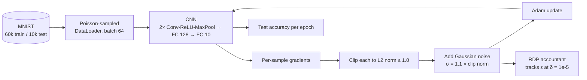
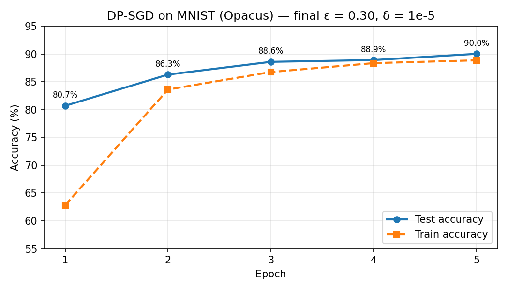

# Differentially Private Digit Recognition (DP-SGD on MNIST)

Trains a convolutional neural network on MNIST with **differentially private SGD** using **PyTorch + Opacus**. It reaches **90.0% test accuracy under a strong privacy budget of ε = 0.30 (δ = 10⁻⁵)**.


## Problem

Neural networks can memorize their training data, and membership-inference and model-inversion attacks can recover facts about individual training examples. **Differential privacy (DP)** bounds how much any single example can influence the trained model. This project measures the practical cost: how accurate can a digit classifier be when every gradient step is clipped and noised to give a formal (ε, δ) guarantee?

## Architecture



## Tech stack

| Area | Tools |
|---|---|
| Deep learning | PyTorch 2.0, torchvision |
| Privacy | Opacus 1.4 (`PrivacyEngine`, `ModuleValidator`, RDP accounting) |
| Environment | Jupyter / Google Colab, CPU or CUDA |

## How it works

1. `ModuleValidator.fix()` makes the CNN DP-compatible (Opacus needs layers that support per-sample gradients).
2. `PrivacyEngine.make_private()` wraps the model, optimizer and data loader, with **noise multiplier 1.1** and **max per-sample gradient norm 1.0**.
3. Training runs for **5 epochs** with Adam (lr = 1e-3) and reports test accuracy after each epoch.
4. The engine's accountant reports the total privacy spent, **ε at δ = 10⁻⁵**.

## How to run

```bash
pip install -r requirements.txt
jupyter notebook dp_sgd_mnist_opacus.ipynb
```

MNIST downloads automatically to `./data/`. The notebook also runs as is on Google Colab.

## Results

| Epoch | Train accuracy | Test accuracy |
|---|---|---|
| 1 | 62.81% | 80.68% |
| 2 | 83.60% | 86.29% |
| 3 | 86.75% | 88.58% |
| 4 | 88.35% | 88.90% |
| 5 | 88.85% | **90.02%** |

**Final privacy budget: ε = 0.30, δ = 10⁻⁵.** Single-digit ε values are generally considered meaningful protection, so ε = 0.30 is a strong guarantee.

Training accuracy is measured during the noisy DP-SGD updates, which is why it trails test accuracy. The remaining gap to non-private CNNs (~99% on MNIST) is the price of privacy. A larger budget, more epochs or bigger batches would close part of that gap.

## Screenshots



## Repo structure

```
.
├── dp_sgd_mnist_opacus.ipynb   # model, DP training loop, privacy accounting (with outputs)
├── images/accuracy_per_epoch.png
└── requirements.txt            # pinned: numpy 1.24.4, torch 2.0.1, torchvision 0.15.2, opacus 1.4.0
```
